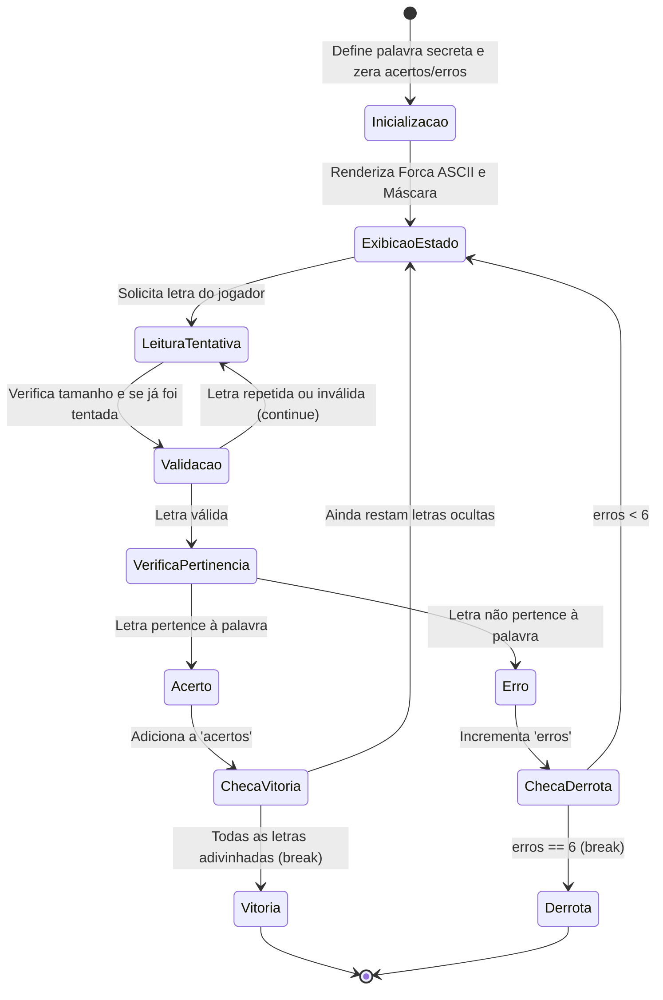

# Aprofundamento Teórico: O Game Loop e a Máquina de Estados da Forca

### 1. Diagrama da Máquina de Estados

O Jogo da Forca opera como um autômato de estados finitos (*FSM*). A cada ciclo do jogador, o programa lê uma entrada, valida sua integridade e decide a transição de estado:



---

### 2. Análise do Código Canônico de Nilo Menezes

Vejamos a implementação completa fiel à Listagem 7.45 do livro (pp. 156–158):

```python
palavra = input("Digite a palavra secreta: ").lower().strip()
for x in range(50):
    print()  # Limpa o console para que o segundo jogador não veja

digitadas = []
acertos = []
erros = 0

while True:
    senha = ""
    for letra in palavra:
        senha += letra if letra in acertos else "."
    print(f"\nPalavra secreta: {senha}")
    
    if senha == palavra:
        print("\nParabéns! Você acertou a palavra secreta!")
        break
        
    tentativa = input("\nDigite uma letra: ").lower().strip()
    if tentativa in digitadas:
        print("Você já tentou esta letra!")
        continue
    else:
        digitadas.append(tentativa)
        if tentativa in palavra:
            acertos.append(tentativa)
        else:
            erros += 1
            print("Você errou!")
            
    # Renderização visual da Forca por linhas:
    print("X==:==")
    print("X  :  ")
    if erros >= 1:
        print("X  O  ")
    else:
        print("X")
    
    linha2 = ""
    if erros == 2:
        linha2 = "  |  "
    elif erros == 3:
        linha2 = " \\|  "
    elif erros >= 4:
        linha2 = " \\|/ "
    print(f"X{linha2}")
    
    linha3 = ""
    if erros == 5:
        linha3 = " /   "
    elif erros >= 6:
        linha3 = " / \\ "
    print(f"X{linha3}")
    print("X\n=======")
    
    if erros == 6:
        print("\nEnforcado!")
        print(f"A palavra secreta era: {palavra}")
        break
```

---

### 3. Técnicas Avançadas e Refatorações dos Exercícios do Livro

1. **Geração Determinística de Palavras (Exercício 7.8):**  
   Para escolher uma palavra secreta de uma lista sem importar `random`, o livro propõe a função hash modular:
   $$\text{índice} = (\text{semente} \times 776) \pmod{\text{len}(\text{lista})}$$
2. **Representação Matricial da Forca (Exercício 7.9):**  
   Em vez de cadeias complexas de `if/elif`, o desenho do cadafalso pode ser armazenado como uma lista de listas de caracteres (`list("X------")`). A adição de cada membro do corpo torna-se uma mutação direta em coordenadas fixas: `gallows[2][3] = 'O'`, `gallows[3][2] = '/'`, etc.
