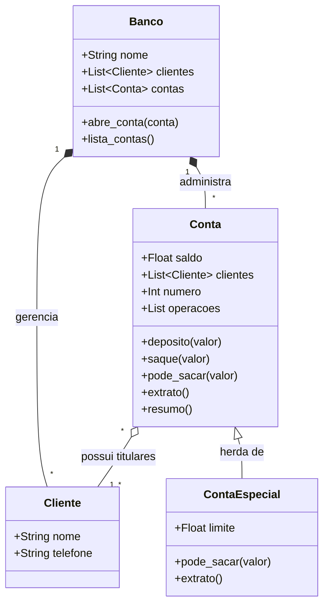

# Aprofundamento Teórico: Arquitetura de Classes do Projeto Bancário

### 1. Diagrama de Classes e Relacionamentos

A modelagem do sistema financeiro canônico envolve três entidades principais relacionadas por agregação e herança:



---

### 2. Implementação das Classes `Cliente` e `Banco`

Vejamos a implementação fiel das classes agregadoras:

```python
class Cliente:
    def __init__(self, nome, telefone):
        self.nome = nome
        self.telefone = telefone

    def __str__(self):
        return f"{self.nome} ({self.telefone})"

class Banco:
    def __init__(self, nome):
        self.nome = nome
        self.clientes = []
        self.contas = []

    def abre_conta(self, conta):
        self.contas.append(conta)

    def lista_contas(self):
        print(f"\n=== RELATÓRIO DO BANCO {self.nome.upper()} ===")
        for c in self.contas:
            c.resumo()
```

---

### 3. Contas Conjuntas e Métodos Mágicos na `ListaÚnica` (Listagem 10.13)

No Exercício 10.8, o livro orienta que uma conta aceite uma lista de clientes para representar contas conjuntas:

```python
joao = Cliente("João da Silva", "777-1234")
maria = Cliente("Maria Silva", "555-4321")

# Conta com dois titulares:
conta_casal = Conta([joao, maria], numero=105, saldo=1500.0)
conta_casal.resumo()
# CC Número: 105 | Saldo: R$ 1500.00
```

#### Os Métodos Especiais (Dunder Methods)
Para controlar coleções de objetos de forma profissional, a classe `ListaÚnica` de Nilo Menezes (p. 230) implementa o protocolo de contêiner do Python:
- `__len__(self)`: Permite usar a função `len(objeto)`.
- `__getitem__(self, i)`: Habilita indexação por colchetes `objeto[0]`.
- `__iter__(self)`: Habilita o uso direto em laços `for item in objeto:`.
- `__str__(self)`: Define como o objeto se converte em texto amigável quando passado para `print()`.

Essa integração transforma classes personalizadas em componentes que se comportam com a mesma naturalidade dos tipos primitivos do núcleo do Python.
