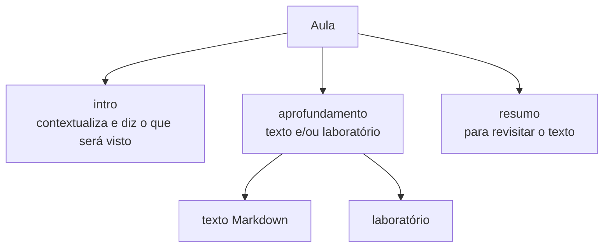

# Arquitetura modular do CourseBook (proposta de schema v0.1)

> Etapa 2 do [plano de refatoração](plano-refatoracao.md). **Somente especificação.** Nenhum código de motor foi alterado. Os JSON Schemas estão em [`schema/`](../schema/): `course`, `lesson`, `lab`, `profile` e `event` (validados com exemplos). **Pendentes:** `module.schema.json`, `quiz.schema.json` e `exercises.schema.json`, a definir junto com a skill v2 (etapa 3).

## 1. Princípios
1. **Conteúdo, formato e blocos são eixos independentes.** O conteúdo diz *o que* ensinar; o **perfil** diz *em que ordem e com quais blocos*; os **blocos** são as peças reutilizáveis.
2. **Dados puros.** Nada de HTML dentro de JS. Texto em Markdown (com LaTeX/KaTeX), estrutura em JSON.
3. **Configurável por padrão, plugável por exceção.** Um curso só traz código próprio (laboratório) quando o catálogo não basta.
4. **Gerável e validável.** A IA escritora produz estes arquivos. O JSON Schema é o contrato e o validador.
5. **Mobile é requisito do modelo**, não ajuste de CSS (campo `mobile` do laboratório, `viewport` nos eventos).
6. **Progresso e métricas são dados separados**, locais, e podem ser exportados.

## 2. Estrutura de pastas de um curso
```
courses/<id>/
  course.json                 # metadados do curso e do livro  (course.schema.json)
  profile.json                # perfil do curso, opcional       (profile.schema.json)
  modules/
    01-<slug>/
      module.json             # lista de aulas e fluxo         (module.schema.json)
      lessons/
        01-<slug>/
          lesson.json         # metadados e lista de blocos    (lesson.schema.json)
          intro.md            # introdução contextual da aula
          aprofundamento.md   # texto principal
          resumo.md           # resumo para revisitar
      quiz.json               # questões (quiz.schema.json)
      exercises.json          # exercícios com resolução
  labs/                       # laboratórios interativos (JS, só quando necessário)
```
O CLRS **não** segue esta estrutura ainda. Ele é lido por um adaptador (etapa 5) que entrega o mesmo modelo em memória.

## 3. Modelo da aula

- **intro**: abre a aula; situa o aluno e diz o que vai aparecer. Não substitui o resumo.
- **aprofundamento**: modo padrão; texto e/ou laboratório, em ordem definida pelo perfil.
- **resumo**: bloco para revisitação. A **revisão do módulo** é montada a partir dos `resumo` de cada aula (uma parte por aula), seguida de quiz e exercícios.
- Uma aula pode ter só laboratório, ou ter um laboratório grande como aula inteira (`"kind": "lab"`).

### Fluxo padrão do módulo
`aulas (aprendizado)` → `revisão (resumos)` → `quiz` → `exercícios`, configurável pelo perfil.

## 4. Blocos
| Tipo | Conteúdo | Origem |
|---|---|---|
| `intro` | Markdown | arquivo `.md` |
| `text` | Markdown com LaTeX e callouts | arquivo `.md` |
| `summary` | Markdown | arquivo `.md` |
| `lab` | Referência a um laboratório (`catalog` ou `custom`) | JSON + JS opcional |
| `quiz` | Questões | `quiz.json` |
| `exercises` | Exercícios com resolução e rascunho | `exercises.json` |

### Sintaxe de callout no Markdown
```md
:::theorem Teorema 3.1
Para quaisquer funções $f(n)$ e $g(n)$, vale ...
:::
```
Catálogo oficial: `theorem`, `key-idea`, `code`, `invariant`, `analogy`, `definition`, `warning`, `note`.
Equivalências na migração: `lemma` → `theorem`; `important` → `key-idea`.
**Tipo especial** por curso: declarado em `course.json` (`customCallouts`) com prefixo `x-`, por exemplo `:::x-prova-por-induçao`. Quem não declara, não pode usar (o validador recusa).

### Laboratório
```json
{ "type": "lab", "id": "heap-lab", "source": "custom", "entry": "labs/heap.js",
  "title": "Laboratório: Heap binário", "mobile": "full" }
```
- `source: "catalog"` usa um laboratório genérico configurado por dados (preferido).
- `source: "custom"` carrega JS do curso. É a exceção plugável. O contrato: o laboratório recebe um elemento de montagem e as opções, sem acesso ao motor.
- `mobile`: `full` | `limited` | `desktop-only`. Em `desktop-only` o motor mostra um aviso e a aula segue utilizável.

## 5. Perfil (formato pedagógico)
Define a ordem dos blocos da aula e o fluxo do módulo. Pode ser definido **no curso** e **sobrescrito por aula**. Um perfil pode **combinar outros** (`extends`, aplicados na ordem; o último vence em conflito).
```json
{
  "id": "pratico",
  "extends": ["padrao"],
  "lesson": ["intro", "lab", "text", "summary"],
  "module": ["lessons", "review", "quiz", "exercises"]
}
```
Perfis embutidos propostos:
| id | `lesson` | Quando usar |
|---|---|---|
| `padrao` | intro → text → summary | Texto denso, teoria |
| `pratico` | intro → lab → text → summary | Cursos de programação |
| `problema-primeiro` | intro → exercises → text → summary | Aprendizado por problema |

Regra de resolução, em ordem de precedência: perfil da aula → perfil do curso → `padrao`. **A ordem dos blocos é do perfil; a apresentação (lado a lado ou empilhado) é do CSS.**

## 6. Livro e direitos autorais
`course.json` exige o bloco `book` (título, autores, edição) e `description` que cita o livro. Campo `contentPolicy`:
- `"paraphrase"` (padrão): texto parafraseado.
- `"quotes"`: permite trechos curtos, sempre com `page`.
O analisador checa a proporção de trechos literais. Uso pessoal e não comercial.

## 7. Progresso e métricas
Dois armazenamentos locais, **separados**:
| Dado | Chave sugerida | Conteúdo |
|---|---|---|
| Progresso (estado atual) | `coursebook:progress:v1` | `{ courses: { <id>: { lessons: { <lessonId>: {done, doneAt} }, quiz: {...} } } }` |
| Métricas (histórico) | `coursebook:events:v1` | lista de eventos |

**Evento** (ver [`event.schema.json`](../schema/event.schema.json)):
```json
{ "ts": "2026-11-01T14:03:22-03:00", "course": "nilo-python", "module": "01", "lesson": "02",
  "type": "lesson_complete", "profile": "pratico", "viewport": 390 }
```
Métricas mínimas e como saem dos eventos:
| Métrica | Evento(s) |
|---|---|
| Tempo por aula | `lesson_open` e `lesson_leave` (com `seconds`) |
| Aulas concluídas | `lesson_complete` |
| Acerto por quiz | `quiz_answer` (`correct: true/false`) |
| Perfil usado | campo `profile` em todo evento |

Exportar/importar JSON entra na etapa 9. O `version` no nome da chave permite migrar sem perder dados.

## 8. Validação
- Todo arquivo de curso é validado contra o schema correspondente.
- Verificações extras do validador (além do schema): callouts dentro do catálogo (ou declarados), arquivos `.md` referenciados existem, `lab.mobile` presente, fórmulas display muito largas (aviso), ids únicos.
- O analisador da skill v2 usa o mesmo validador antes de avaliar cobertura e fidelidade.

## 9. Pontos em aberto para a etapa 3 e 4
1. Biblioteca de Markdown (ex.: `marked` + extensão de diretivas) e como carregá-la sem build.
2. Catálogo inicial de laboratórios genéricos configuráveis (ex.: simulador de passos de algoritmo, visualizador de variáveis).
3. Como medir `lesson_leave` de forma confiável (aba oculta, fechamento da página).
4. Política de IDs estáveis para que o progresso sobreviva a reordenação de aulas.
