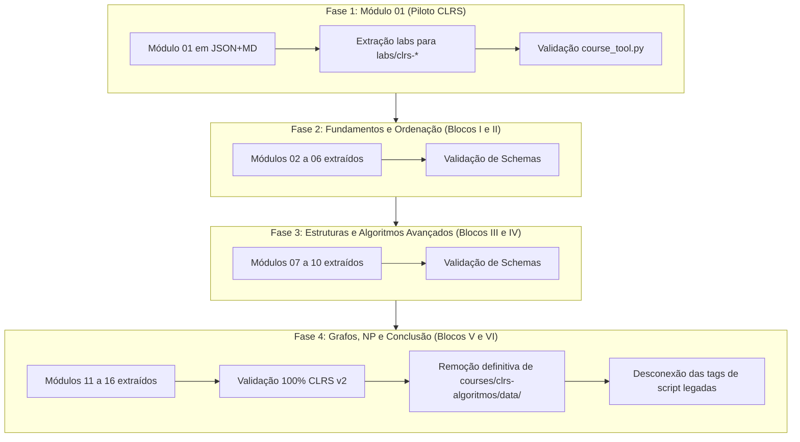

# Planejamento de Conversão Canônica do CLRS para o Formato Modular v2

> **Documento de Arquitetura & Plano de Execução (Etapa 10)**  
> Baseado nas decisões de [plano-refatoracao.md](plano-refatoracao.md), [architecture.md](architecture.md) e na validação bem-sucedida do piloto **Nilo Python**.

---

## 1. Contexto e Diagnóstico

O curso **Algoritmos: Teoria e Prática (CLRS 3ª Edição)** é o maior e mais denso acervo da plataforma CourseBook:
- **16 Módulos Temáticos Completos** cobrindo os 35 capítulos e 4 apêndices da obra.
- **~28.000 linhas de código JavaScript** distribuídas em `courses/clrs-algoritmos/data/` (`curriculum.js`, `module2.js` a `module16.js` e `module1-labs.js`).
- **160 questões de quizzes dialéticos** com comentário detalhado de todas as alternativas.
- **128 problemas e exercícios canônicos** com demonstrações matemáticas e soluções passo a passo.
- **Dezenas de laboratórios tácteis interativos** (Insertion-Sort com invariante, Merge-Sort com sentinelas, Heap binário, Partição de Quicksort, Árvores RB, Programação Dinâmica, etc.).

### Por que a conversão agora é muito mais simples?
1. **O conteúdo já está todo planejado e redigido:** Não é necessário criar textos pedagógicos do zero nem formular novas questões de quiz — o trabalho consiste em **extrair** o conteúdo estruturado dos arquivos `.js` e **distribuí-lo** nas pastas canônicas v2 (`module.json`, `quiz.json`, `exercises.json`, `checklist.json`, `lessons/`).
2. **O motor modular v2 (`loadModularCourse`) já está pronto e testado:** Funciona com `fetch`, KaTeX nativo, callouts editoriais (`:::theorem`, `:::key-idea`, `:::invariant`, `:::analogy`, etc.) e instanciador de laboratórios do catálogo.
3. **A skill construtora v2 (`course_tool.py`) já possui validador oficial:** Qualquer módulo extraído pode ser auditado em segundos via `course_tool.py validate`.

---

## 2. Estrutura Canônica de Destino (v2)

Cada um dos 16 módulos do CLRS será migrado para a seguinte estrutura em `courses/clrs-algoritmos/`:

```
courses/clrs-algoritmos/
├── course.json                 # Metadados do curso e citação da 3ª edição do CLRS
├── curriculum.json             # Trilha dos 16 módulos agrupados em 6 blocos canônicos
└── modules/
    ├── 01-papel-dos-algoritmos-e-partida/
    │   ├── module.json
    │   ├── quiz.json           # 10 questões comentadas (A, B, C, D)
    │   ├── exercises.json      # 8 problemas com rascunho integrado
    │   ├── checklist.json      # Checklist de prontidão conceitual
    │   └── lessons/
    │       ├── 01-algoritmos-computacao/
    │       │   ├── lesson.json
    │       │   ├── intro.md
    │       │   ├── aprofundamento.md
    │       │   └── resumo.md
    │       ├── 02-insertion-sort-invariante/
    │       ├── 03-analise-tempo-recorrencias/
    │       └── 04-laboratorios-modulo-01/
    ├── 02-crescimento-de-funcoes-e-assintotica/
    │   └── ...
    └── 16-problemas-np-completos-e-aproximacao/
```

Os laboratórios interativos serão movidos para o catálogo desacoplado:
```
labs/
├── clrs-scale-duel.js          # Duelo Computador A vs. Computador B (Problema 1-1)
├── clrs-insertion-sort.js      # Simulador passo a passo de Insertion-Sort
├── clrs-merge-sort.js          # Intercalação com Sentinelas de Infinito
├── clrs-heap-simulator.js      # Árvore Heap binária interativa
├── clrs-quicksort.js           # Partição de Lomuto e Hoare
└── clrs-red-black-tree.js      # Inserção e rotações em Árvores RB
```

---

## 3. Estratégia de Transição Não Destrutiva (Zero Downtime)

A migração será executada progressivamente em **4 Fases**, garantindo que o curso CLRS permaneça 100% operacional a cada passo:



1. **Prioridade Dinâmica no Motor (`app.js`):**
   - O carregador modular verifica se `courses/clrs-algoritmos/modules/<modFolder>/` existe. Se existir, carrega os dados modulares limpos em JSON+MD.
   - Os módulos ainda não convertidos continuam sendo servidos pelo adaptador de compatibilidade em memória.
2. **Automação via Script Extrator:**
   - Criar script utilitário (`scripts/convert_clrs_module.mjs`) que lê os objetos JS exportados em `courses/clrs-algoritmos/data/` e gera automaticamente o scaffold modular v2, formatando HTML para Markdown limpo com callouts e KaTeX.

---

## 4. Cronograma de Execução Módulo a Módulo

| Fase | Módulos Abrangidos | Tópicos do CLRS | Laboratórios a Desacoplar |
| :--- | :--- | :--- | :--- |
| **Fase 1** | **Módulo 01** | Cap. 1 e 2: O Papel dos Algoritmos, Insertion-Sort e Análise | `scale-duel`, `insertion-sort`, `merge-sort` |
| **Fase 2** | **Módulos 02 a 06** | Cap. 3 a 9: Notação Assintótica, Recorrências, Probabilidade, Heapsort, Quicksort e Limites Lineares | `heap-simulator`, `quicksort-partition`, `counting-radix` |
| **Fase 3** | **Módulos 07 a 10** | Cap. 10 a 21: Estruturas Elementares, Tabelas Hash, Árvores BST/RB, Programação Dinâmica, Gulosos e Árvores B | `hash-table`, `red-black-tree`, `lcs-dynamic-programming`, `huffman-greedy` |
| **Fase 4** | **Módulos 11 a 16** | Cap. 22 a 35: Grafos (BFS/DFS, MST, Dijkstra, Fluxo Máximo), FFT, Geometria e Intratabilidade NP | `graph-bfs-dfs`, `dijkstra-shortest-path`, `graham-scan`, `sat-reduction` |

---

## 5. Critérios de Aceite por Módulo Convertido

Para cada módulo migrado:
1. `course_tool.py validate --course-dir "courses/clrs-algoritmos"` aprovado com **100% de sucesso**.
2. Todas as aulas com `intro.md`, `aprofundamento.md` e `resumo.md` estruturados, com fórmulas matemáticas KaTeX e callouts canônicos (`theorem`, `key-idea`, `invariant`, `analogy`).
3. 10 Quizzes dialéticos com todas as alternativas comentadas (`A`, `B`, `C`, `D`).
4. 8 Exercícios clássicos com solução passo a passo e rascunho persistido.
5. Laboratórios interativos tácteis operando a partir do catálogo `labs/`.
6. Validação ponta a ponta no Google Chrome Headless via DevTools Protocol sem erros de console.
