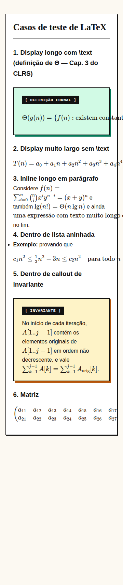
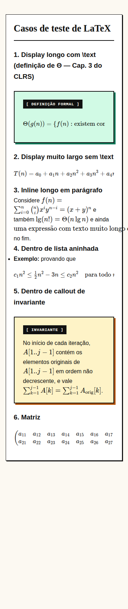
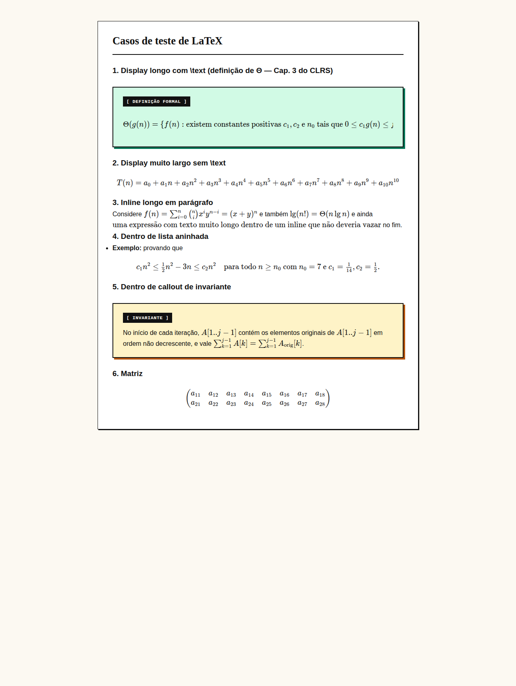

# Etapa 0 e 1 — Rede de segurança e correção do LaTeX

**Tag de retorno:** `v0-pre-refactor` · **Plano geral:** [plano-refatoracao.md](../plano-refatoracao.md)

## Problema
Fórmulas LaTeX ultrapassavam a borda do cartão da aula e dos callouts, prejudicando a leitura.

## Causa (diagnosticada)
`styles.css` não tinha nenhuma regra para `.katex-display`. Resultado:
1. Fórmulas em display (`$$…$$`) não tinham `overflow`, então estouravam o container.
2. Cartões e callouts não tinham `min-width: 0`, então não encolhiam abaixo do conteúdo.
3. Fórmulas inline são indivisíveis no KaTeX. Um `\text{…}` longo vira uma caixa única.

## Decisão
- Display: rolagem horizontal **dentro do próprio bloco**, mantendo a fórmula íntegra (padrão de livros digitais).
- Não forçar quebra de linha em fórmulas matemáticas via CSS, pois isso pode alterar a leitura.
- Inline com `\text` longo é problema de **conteúdo** (virar display). Fica registrado em [visual-debt.md](../visual-debt.md), item 14.
- Criada a página de regressão `tests/latex.html` com os piores casos do CLRS.

## Resultado
| Antes (360 px) | Depois (360 px) |
|---|---|
|  |  |

Em 1280 px: 

## Como reproduzir
```bash
python3 -m http.server 8000   # abrir http://localhost:8000/tests/latex.html
```

## Commits
Ver `git log` entre `v0-pre-refactor` e `refactor/01-latex`.
