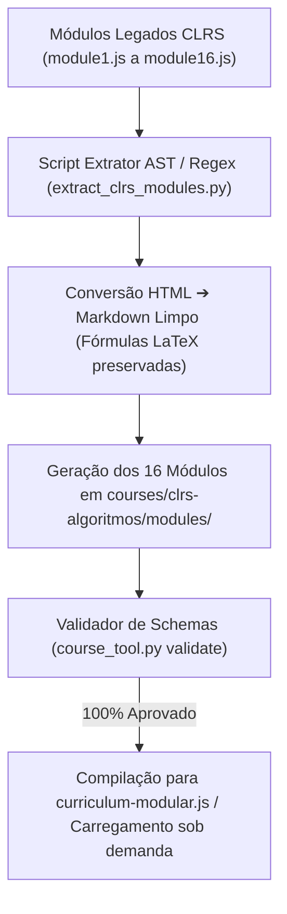

# Planejamento da Conversão Modular do CLRS (Módulos 01 a 16)

> Documento de arquitetura e especificação da migração dos 16 módulos do curso **Algoritmos: Teoria e Prática (CLRS)** do formato legado monolítico JavaScript (`curriculum.js` e `moduleN.js`) para a arquitetura modular canônica v2 (**JSON + Markdown**).

---

## 1. Contexto e Motivação

Atualmente, o ecossistema **CourseBook** opera em arquitetura híbrida:
1. **Curso Piloto Nilo-Python:** Estruturado 100% no formato moderno modular v2 (`courses/nilo-python/modules/01-computador-e-interpretador/` contendo `module.json`, `quiz.json`, `exercises.json` e lições com `intro.md`, `aprofundamento.md`, `resumo.md`), validado em 100% pelo `course_tool.py`.
2. **Curso CLRS (Algoritmos):** Funciona através do motor moderno `app.js` graças a um adaptador retrocompatível que lê `curriculum.js` e os arquivos `module2.js` a `module16.js`. Embora esses arquivos tenham sido limpos e modernizados (eliminação de colchetes, renomeação para "Laboratório Interativo" e "CourseBook"), eles ainda residem em arquivos JavaScript gigantescos contendo HTML e JSON concatenados em templates literais.

A conversão completa para o formato **JSON + Markdown** permitirá:
- Edição de conteúdo puro em Markdown legível sem risco de corrupção sintática de JavaScript.
- Validação contínua de integridade via `course_tool.py validate` para os 16 módulos.
- Desacoplamento definitivo de código e dados.
- Carregamento assíncrono sob demanda (on-demand streaming), tornando a plataforma instantânea.

---

## 2. Estrutura Canônica de Destino

Cada módulo do CLRS será transposto para `courses/clrs-algoritmos/modules/NN-<slug>/`:

```
courses/clrs-algoritmos/modules/
├── 01-papel-dos-algoritmos/
│   ├── module.json
│   ├── quiz.json
│   ├── exercises.json
│   ├── labs.js (ou embutido no motor/lab)
│   └── lessons/
│       ├── 01-algoritmos-e-tempo/
│       │   ├── lesson.json
│       │   ├── intro.md
│       │   ├── aprofundamento.md
│       │   └── resumo.md
│       ├── 02-insertion-sort-e-invariantes/
│       └── ...
├── 02-crescimento-de-funcoes/
│   ├── module.json
│   ├── quiz.json
│   ├── exercises.json
│   └── lessons/
│       ├── 01-notacao-assintotica-theta-o-omega/
│       └── ...
...
└── 16-intratabilidade-computacional-e-np/
    ├── module.json
    ├── quiz.json
    ├── exercises.json
    └── lessons/
```

---

## 3. Mapeamento de Extração de Dados

| Fonte Legada (`moduleN.js`) | Destino Canônico v2 | Formato / Transformação |
|---|---|---|
| `modMeta` em `curriculum.js` | `module.json` | Metadados do módulo, referências de capítulos e lista ordenada de IDs de aulas |
| `unidades[i]` | `lessons/XX-<slug>/lesson.json` | Metadados da aula (ID, título, páginas, blocos configurados) |
| Introdução contextual da aula | `lessons/XX-<slug>/intro.md` | Contextualização inicial do capítulo |
| `unidades[i].content` | `lessons/XX-<slug>/aprofundamento.md` | Teoria analítica, teoremas, demonstrações e pseudocódigo em Markdown puro com KaTeX |
| `revisao.pillars[i].body` | `lessons/XX-<slug>/resumo.md` | Síntese de fixação rápida da respectiva aula |
| `quizzes` | `quiz.json` | 10 questões dialéticas com enunciado, alternativas e gabarito comentado |
| `exercicios` | `exercises.json` | 8 problemas com enunciado, referência e guia analítico de resposta |
| `initWorkbenches` | `labs.js` ou bloco `lab` | Funções vanilla JS dos simuladores interativos |

---

## 4. Pipeline de Execução Automatizada

A transição será executada de forma automatizada e auditável através de um script de extração estruturada:



### Regras do Extrator:
1. **Preservação Matemática KaTeX:** Expressões inline `$ ... $` e display `$$ ... $$` não podem sofrer escape ou perda de barras invertidas (`\`).
2. **Pseudocódigos Editoriais:** Tags `<div class="code-box">` ou tabelas de linhas de código são convertidas para blocos de código com highlight ou estrutura Markdown preservada.
3. **Callouts:** Chamadas `<div class="canonical-callout <tipo>">` são mapeadas diretamente para a sintaxe nativa de diretivas `:::<tipo> [Título]`.
4. **Resumos e Introduções:** Cada aula recebe seu `intro.md` contextualizado e seu `resumo.md` derivado do pilar correspondente de revisão.

---

## 5. Cronograma por Lotes

- **Lote 1 (Bloco I — Fundamentos):** Módulos 01 a 03 (Módulo 1, Notação Assintótica, Divisão e Conquista).
- **Lote 2 (Bloco II — Ordenação e Estruturas Elementares):** Módulos 04 a 07 (Análise Probabilística, Heapsort & Quicksort, Tempo Linear, Tabelas Hash).
- **Lote 3 (Bloco III — Estruturas Avançadas):** Módulos 08 a 10 (Árvores RB, Programação Dinâmica & Gulosa, B-Trees & Conjuntos Disjuntos).
- **Lote 4 (Bloco IV — Grafos e Algoritmos Especializados):** Módulos 11 a 13 (Grafos & MST, Caminhos Mínimos & Fluxo, Multithreading & Simplex).
- **Lote 5 (Bloco V — Tópicos Avançados e Teoria da Complexidade):** Módulos 14 a 16 (FFT & Teoria dos Números, String Matching & Geometria, NP-Completude & Aproximação).

---

## 6. Critérios de Aceite
1. Todos os 16 módulos do CLRS validados em **100% de conformidade** pelo `course_tool.py validate`.
2. Zero erros de console ou quebra de layout ao alternar entre módulos.
3. Retrocompatibilidade garantida com o progresso anterior salvo via `coursebookExportData()`.
