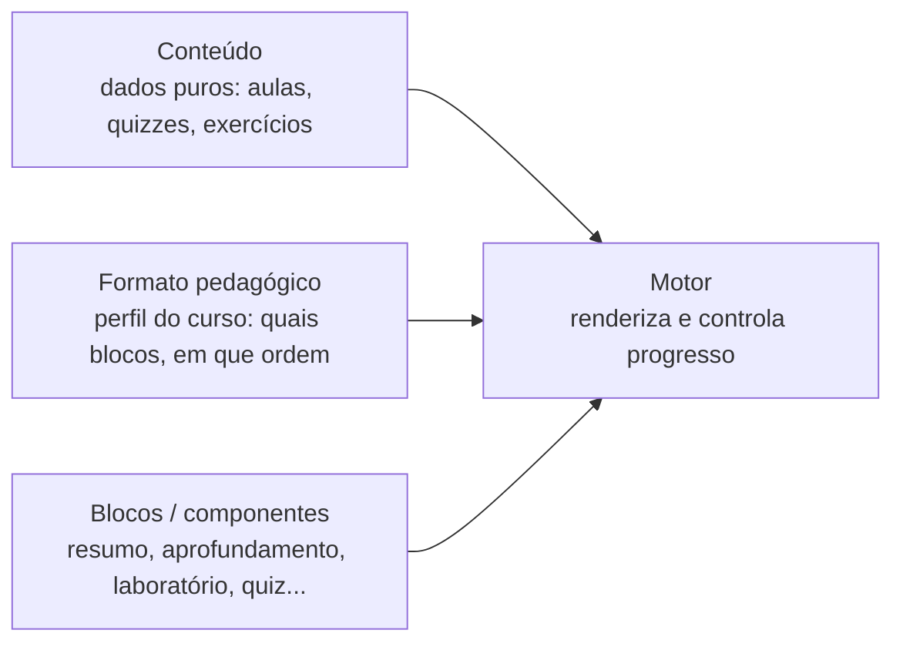
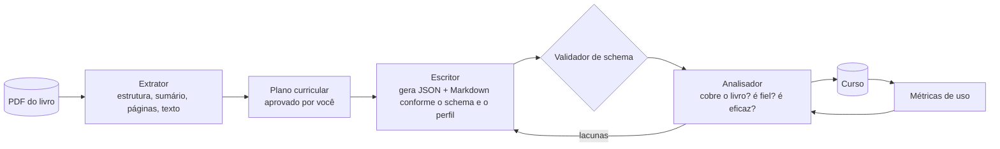

# CourseBook — Plano de revisão e refatoração (documento de raciocínio)

> Este documento não é um cronograma fechado. É um mapa de decisões, com uma ordem sugerida e as perguntas que acho que valem responder antes de mexer no código.

## 1. O que encontrei no código (diagnóstico)

| Item | Situação atual |
|---|---|
| Estrutura | Frontend estático (HTML/CSS/JS puro, sem build). `index.html` (carrega cada `moduleN.js` por `<script>`), `app.js` (1768 linhas), `styles.css`. |
| Cursos | `courses/<id>/course.json` + `data/curriculum.js` + `data/moduleN.js`. Três cursos: CLRS (16 módulos), Nilo-Python (1 módulo), Forbellone (só planejado). |
| Módulo | Cada `moduleN.js` chama `registerCodexModule(n, { revisao, unidades, initWorkbenches, quizzes, exercicios })`. |
| Etapas fixas | `STEP_KEYS = ["revisao","aprendizado","quizzes","exercicios"]` fixo em `app.js`. A revisão vem **antes** do aprendizado. |
| Conteúdo | Strings HTML dentro de template literals JS, com LaTeX escapado (`\\\\Theta`). Cada módulo tem 1.400–2.300 linhas. |
| Bancadas | Em `app.js` (linhas ~869–1400) há bancadas do módulo 1 do CLRS **escritas dentro do motor**. O motor não é genérico. |
| Nomes herdados | `CODEX_DATA`, `registerCodexModule`, `COURSES_REGISTRY`, "TOMO #01", classes `workbench-*`, `clrs-pseudocode-box`. |

**Conclusão central:** hoje o formato do curso é *código*. O motor, o conteúdo e o formato pedagógico estão misturados. Isso é o principal obstáculo para a modularidade que você quer.

## 2. Problema do LaTeX: causa provável

Não encontrei nenhuma regra para `.katex` ou `.katex-display` em `styles.css`. As causas são combinadas:

1. **Fórmulas display (`$$…$$`) sem scroll.** O KaTeX gera `.katex-display` com largura do conteúdo, mas sem `overflow-x`. Fórmulas longas, como a definição de Θ(g(n)) com `\text{…}`, ultrapassam o container.
2. **Fórmulas inline não quebram linha.** O KaTeX trata cada fórmula como uma caixa indivisível (`white-space: nowrap`). Uma fórmula inline longa estoura a linha.
3. **Falta `min-width: 0` nos filhos de grid/flex.** `.reader-main` já tem, mas o conteúdo da aula e os `.canonical-callout` não têm. Um item de grid não encolhe abaixo do conteúdo.
4. **Texto dentro de `\text{}` não quebra.** As definições longas usam `\text{existem constantes…}` e esse texto vira uma linha única.

**Correção proposta, em camadas (da mais segura à mais invasiva):**
```css
.lesson-body, .canonical-callout { min-width: 0; max-width: 100%; }
.katex-display { overflow-x: auto; overflow-y: hidden; max-width: 100%; padding: .25em 0; }
.katex { overflow-wrap: anywhere; }            /* só para inline; testar */
```
- Display: scroll horizontal discreto. É o padrão em livros digitais e mantém a fórmula íntegra.
- Inline longa: revisar a fórmula no conteúdo (virar display). Evitar forçar quebra no CSS, que pode corromper a leitura matemática.
- Fórmulas display muito longas com `\text`: quebrar em `\begin{aligned}` ou em `\\`. Isso é decisão de conteúdo, não de CSS.
- Mobile: reduzir `font-size` do `.katex-display` em telas estreitas.

Antes de corrigir, vale criar uma **página de teste de LaTeX** (`/tests/latex.html`) com os piores casos reais do CLRS e olhar em 3 larguras (360, 768, 1280 px). Isso também serve como regressão.

## 3. Artefatos visuais herdados: só o mapeamento

Candidatos (a confirmar com você na etapa seguinte):
- Textos de interface com a marca "CODEX", "TOMO #01", ISBN e "BANCADA INTERATIVA #01" no cabeçalho, em colchetes e caixa-alta.
- Tags `[ … ]` em todo callout e etapa (estilo "terminal" da primeira ideia).
- Estética "Brutalista / Paper & Ink": sombras duras (`box-shadow: 4px 4px`), bordas pretas grossas.
- Terminais de pseudocódigo escuros (`.clrs-pseudocode-box`) com nome ligado ao CLRS, usados em outros cursos.
- Hero da home com descrição fixa em CLRS; README totalmente centrado em CLRS.
- "Bancada de rascunho" nos exercícios, que usa a mesma palavra que será renomeada.
- PDF solto na raiz (ignorado pelo `.gitignore`, mas sem lugar definido).
- Contadores fixos em texto ("160 questões", "79+ procedimentos") que ficam desatualizados.

Proposta: criar `docs/visual-debt.md` com uma tabela *artefato → onde aparece → decisão (manter/remover/renomear)*, sem mexer em nada ainda.

## 4. Decisões de arquitetura a tomar antes de codar

### 4.1 O modelo modular — a decisão mais importante

Minha sugestão para pensar: separar **três eixos independentes**.



- **Conteúdo** descreve *o que* ensinar. Não sabe como será exibido.
- **Blocos** são peças reutilizáveis (resumo, texto, laboratório, quiz, exercício, revisão). Cada um registra um tipo.
- **Formato (perfil)** é um arquivo de configuração por curso que escolhe e ordena blocos. Ex.: `"aula": ["resumo","aprofundamento","laboratorio"]` para o CLRS e `["resumo","laboratorio","aprofundamento"]` para um curso de Python mais prático.

Isso responde direto ao "combinar partes diferentes para descobrir o que funciona": trocar de formato vira trocar um perfil, não reescrever módulos.

### 4.2 Formato dos dados
| Opção | Prós | Contras |
|---|---|---|
| **A. Manter JS com HTML em string** | Zero migração | Difícil de gerar por IA com segurança, escape de `\\\\` frágil, sem validação |
| **B. JSON + Markdown com KaTeX (recomendado)** | Gerável por IA/prompt, validável por schema, LaTeX sem escape duplo, diffs legíveis | Exige migração e um parser Markdown (ex.: `marked`) |
| **C. Um arquivo `.md` por aula com front-matter** | Melhor para autoria e para o objetivo "PDF → curso" | Mais arquivos; precisa de um índice |

Por que importa: sua visão final é *gerar cursos a partir de PDFs*. Um schema estável (B ou C) é o contrato entre o prompt de geração e a plataforma. Em HTML-em-JS, esse contrato não existe.

### 4.3 Migrar ou não migrar o CLRS agora
São ~28 mil linhas de conteúdo. Proposta: **adaptador de compatibilidade**. O motor novo lê o formato antigo (`unidades`) e o converte em memória para o modelo novo de aulas. Assim o CLRS continua funcionando e você migra o conteúdo por curso, começando pelo **Nilo-Python** (pequeno, em desenvolvimento) como piloto.

### 4.4 Persistência de progresso
O `localStorage` guarda `completedSteps[mod][step]`. O novo modelo precisa de `completed[curso][modulo][aula]`. Decidir: migrar progresso antigo ou aceitar zerar? (Uso pessoal: provavelmente aceitável, mas vale decidir de forma explícita.)

### 4.5 Sem build, ou com build?
Hoje roda no GitHub Pages sem build. Usar JSON/Markdown exige carregar com `fetch` (não funciona abrindo `file://`). Opções: servidor local simples (`python -m http.server`) ou manter script de build que gera um bundle. Recomendo **fetch + servidor local**, sem ferramenta de build, para preservar a simplicidade.

## 5. O que muda, em termos de conceito

| Pedido | Implicação técnica |
|---|---|
| Seção → **Aula** (unidade básica, no menu lateral, com "concluído") | Renomear `unidades`→`aulas` nos dados e na UI. O check por aula já existe em parte (`completedSteps` é por etapa, não por aula). Precisa de progresso por aula. |
| Modo padrão **aprofundamento**: resumo primeiro, depois texto/laboratório | A aula passa a ter `resumo` (curto) + `aprofundamento` (blocos). Hoje a "revisão" faz papel de resumo, mas no nível do módulo. O resumo por aula é conteúdo **novo ou extraído** da revisão atual. |
| "Bancada interativa" → **Laboratório interativo** | Renomear UI, CSS (`workbench-*`→`lab-*`), `initWorkbenches`→`initLabs`. Mecânico, mas atinge muitos arquivos. Fazer com alias de transição. |
| Manter caixas (teorema, ideia-chave, código) | Já existe `.canonical-callout.{invariant,theorem,analogy}`. Formalizar como blocos tipados: `theorem`, `key-idea`, `code`. Atenção: "invariante" e "analogia" não estão na sua lista; manter ou fundir? |
| **Revisão** = resumo, uma parte por aula, depois quiz e exercícios | Fluxo final do módulo: Aulas → Revisão → Quiz → Exercícios. A revisão deixa de ser a primeira etapa (hoje é). Idealmente é **gerada** a partir dos `resumo` das aulas, eliminando duplicação. |

## 6. Ordem revisada (após suas decisões)

O que mudou em relação à primeira versão: o **schema** e a **skill construtora** passam a ser o centro, porque a IA escreve os cursos. Se o schema mudar, a skill precisa mudar junto. Por isso a skill entra no plano como parte da arquitetura, e não como detalhe de fim de caminho.

### 6.1 Achados sobre a skill `coursebook-builder`
A skill atual **gera exatamente o formato que queremos abandonar**:
- Produz `moduleN.js` com `registerCodexModule(ID, { revisao, unidades, initWorkbenches, quizzes, exercicios })`.
- Embute o vocabulário antigo: "bancada", `.workbench-box`, "Modo Revisão", "design brutalista".
- `validate` checa classes CSS legadas e sintaxe JS. Com JSON+Markdown, isso vira validação de **schema** e de links.
- Já tem um fluxo bom: *inspecionar → planejar com aprovação → construir módulo 1 → validar → módulos seguintes*. Esse fluxo **é** o embrião do extrator/escritor/analisador. Vale preservar.
- Suas regras de qualidade ("resumos superficiais", "comentar todos os distratores", "crases em template literal") são conhecimento valioso. As crases deixam de ser problema com Markdown em arquivo próprio. As outras viram critérios do **analisador**.

### 6.2 Arquitetura extrator → escritor → analisador

- **Extrator**: já existe (`inspect`/`extract`). Passa a emitir um `book-map.json` (capítulos, páginas, conceitos) que o analisador reutiliza.
- **Escritor**: um prompt por tipo de bloco, guiado pelo perfil. O contrato é o schema.
- **Analisador**: dois níveis. (a) *Cobertura e fidelidade*, comparando o curso com o `book-map` do livro. (b) *Eficácia*, usando as métricas de uso (acerto nos quizzes, aulas abandonadas). Só (a) é possível antes de usar o curso. O (b) fecha o ciclo "descobrir qual formato funciona".
- **Direitos autorais**: o escritor parafraseia, trechos curtos entre aspas com página, e o livro é citado em `course.json` (título, autor, edição, descrição). O analisador pode checar a proporção de trechos literais.

### 6.3 Persistência e métricas (tema novo)
Você disse que quer pensar um plano de persistência. Opções, da mais simples à mais robusta:

| Nível | Como | Quando faz sentido |
|---|---|---|
| 1 | `localStorage`, com versão no schema (`{version, courses:{…}}`) | Agora; uso pessoal em um navegador |
| 2 | **Exportar/importar JSON** do progresso e das métricas | Logo depois; protege contra perda e permite versionar suas métricas no git |
| 3 | `IndexedDB` | Se as métricas ficarem volumosas (eventos por aula) |
| 4 | Backend ou sincronização | Só se virar multiusuário; fora do escopo hoje |

**Recomendação**: começar no nível 1 já com **registro de eventos** (`{curso, aula, bloco, tipo, timestamp, perfil}`) em vez de só um estado. Com eventos você consegue calcular qualquer métrica depois, inclusive as que ainda não pensou. O nível 2 vem logo em seguida. Decisão central: o **progresso** (estado atual) e as **métricas** (histórico) ficam separados.

### 6.4 Ordem sugerida

Continua sem prazos. A ordem agora é:

| # | Etapa | O que entrega | Depende de |
|---|---|---|---|
| 0 | **Rede de segurança**: tag `v0-pre-refactor`, `docs/visual-debt.md`, página de teste de LaTeX, confirmar PDFs não rastreados (já confirmei: **nenhum PDF está no git**) | Ponto de retorno | — |
| 1 | **Correção do LaTeX** (só CSS) | Resultado visível, baixo risco | 0 |
| 2 | **Decisão de schema** em `docs/architecture.md` + JSON Schema: curso, módulo, aula (`intro`, blocos), tipos de bloco, catálogo de callouts, perfil (com composição), eventos de métricas. *Só documento.* | Contrato para tudo que vem depois | decisões da seção 10 |
| 3 | **Revisão da skill construtora** em paralelo ao schema: escrever a versão 2 (novo schema, novo vocabulário, validação por schema, analisador de cobertura). *Pode usar o Nilo-Python como caso de teste.* | A IA passa a gerar o formato novo | 2 |
| 4 | **Motor novo**: carregamento por `fetch`, blocos configuráveis, perfis, progresso por aula, registro de eventos (nível 1 de 6.3) | Plataforma que lê o formato novo | 2 |
| 5 | **Adaptador do CLRS**: lê `unidades`/`revisao` antigos e entrega o modelo novo em memória; extrai as bancadas de `app.js` para o curso | CLRS segue funcionando no motor novo | 4 |
| 6 | **Vocabulário na UI**: aula, laboratório, rascunho, catálogo de callouts com CSS para cada tipo | Interface coerente | 4 (aproveita 2) |
| 7 | **Piloto Nilo-Python**: reescrever o módulo 1 pela skill v2 e comparar dois perfis | Primeira validação real do modelo | 3, 4 |
| 8 | **Revisão e fluxo do módulo**: resumos por aula alimentam a revisão; ordem aprendizado → resumo → quiz → exercícios | Fluxo final | 4, 7 |
| 9 | **Persistência nível 2** (exportar/importar) e painel simples de métricas | Dados para comparar formatos | 4 |
| 10 | **Planejamento da conversão do CLRS** (projeto à parte, módulo a módulo) e **limpeza dos artefatos visuais** | Fim da dívida herdada | 5, 7 |

**Por que não mover o LaTeX para depois?** Ele é independente de tudo e vale como primeiro documento de evolução no README (antes/depois). **Por que o schema antes do motor?** Motor e skill dependem dele, e é a decisão mais cara de desfazer. **Por que o piloto antes de converter o CLRS?** Você disse que converter o CLRS deve ser mais fácil por já estar planejado. Isso é verdade para o conteúdo, mas só é seguro depois que o modelo provou funcionar em escala pequena.

> [!TIP]
> As etapas 3 e 4 podem andar em paralelo depois da 2, porque ambas só dependem do schema. É o ponto onde dá para dividir o trabalho.

## 7. Perguntas para você se fazer sobre o modelo modular

- A **aula** sempre terá resumo + aprofundamento, ou algum curso pode ter aulas só com laboratório?
- O **formato é por curso, por módulo ou por aula**? (Quanto mais granular, mais flexível e mais complexo.)
- Como você vai **comparar formatos**? Só impressão pessoal, ou registrar algo (tempo de estudo, acertos no quiz por formato)? Isso muda se o motor precisa emitir métricas.
- O **laboratório** é um bloco dentro da aula, ou pode ser uma aula inteira?
- Os blocos devem ser **só configuráveis** ou também **plugáveis** (um curso traz seu próprio componente)? O segundo é poderoso, mas aumenta superfície de segurança e complexidade.
- Quem escreve o conteúdo: você, ou um **prompt de IA**? Se for IA, o schema precisa ser validável (JSON Schema) e tolerante a erros.
- Para o objetivo "PDF → curso" com cuidado autoral: o curso gerado guarda **trechos do livro** ou **só paráfrase e estrutura**? Isso afeta o que pode ir para o GitHub público (veja 8).
- Novas formas de estruturar o conteúdo a experimentar: **pergunta antes da explicação** (aprendizado por problema), **exemplo resolvido → exercício análogo** (worked examples), **recuperação espaçada** (revisão volta depois de N dias), **trilha adaptativa** (pular aula se o quiz inicial for alto), **explique com suas palavras** (campo livre salvo localmente). Cada uma é um bloco ou um perfil no modelo acima.

## 8. Direitos autorais e repositório

- Os PDFs já estão no `.gitignore` (bom). Mas `courses/clrs-algoritmos/livro.pdf` e `forbellone.pdf` aparecem na árvore; confirmar que **não estão rastreados** (`git ls-files | grep pdf`).
- O conteúdo escrito (resumos, aulas) parece paráfrase e análise, mas inclui "pseudocódigos originais dos autores" e "problemas do livro". Para um repositório público, vale decidir uma política (trechos curtos com citação, ou apenas referência a páginas). Sugiro registrar a política no README.

## 9. Commits e seção de evolução no README

**Padrão de commits** (Conventional Commits em português, com escopo por eixo):
```
<tipo>(<escopo>): <resumo imperativo>

tipo:   feat | fix | refactor | docs | style | chore | test
escopo: engine | lesson | lab | review | latex | schema | course/<id> | readme
```
Exemplos: `fix(latex): permite rolagem horizontal em fórmulas display`, `refactor(lab): renomeia bancada interativa para laboratório`.

**Rastreabilidade:**
- Uma **tag por marco** (`refactor/01-latex`, `refactor/02-vocabulario`…), em vez de depender só do histórico.
- Um **`docs/evolucao/NN-titulo.md` por etapa**: problema → decisão (e alternativas descartadas) → resultado → commits/tag. Funciona como mini ADR (registro de decisão de arquitetura).
- No README, seção **"Evolução do projeto"** com uma tabela *etapa | o que mudou | por quê | link para o doc e a tag*, mais um parágrafo sobre a visão (PDF → curso). Capturas de tela antes/depois (principalmente do LaTeX) são ótimas para portfólio.
- Registrar também o estado inicial (os 3 commits atuais) como "Etapa 0".

## 10. Decisões tomadas e pendências

### Decididas
| Tema | Decisão |
|---|---|
| Formato de dados | **JSON + Markdown** (opção B), LaTeX com KaTeX. |
| CLRS | Só **adaptador** agora; conversão para o formato novo vira um planejamento próprio (extrair do JS antigo e estruturar). |
| Callouts | Manter **invariante** e **analogia** (ver nota abaixo). |
| Progresso | Pode ser zerado. Mas a **persistência vira um tema de projeto** (ver 6.3). |
| Aula | Abre com **introdução contextual** (o que será visto e por quê), distinta do **bloco resumo**, que serve para revisitar o texto. |
| Formato pedagógico | **Por curso e por aula**. Sequência padrão do módulo: aprendizado → resumo → quiz → exercícios. Perfis podem **combinar** outros perfis. |
| Laboratório | Bloco dentro da aula; se for grande, uma aula inteira. |
| Blocos | **Configuráveis** por padrão; plugáveis só em casos extraordinários. |
| Métricas | **Sim**, desde cedo, por robustez e para comparar formatos. |
| Autoria | IA escreve. Arquitetura **extrator → escritor → analisador**. IA parafraseia, pode trazer trechos curtos, e o livro é sempre citado (título e descrição do curso). |

> [!NOTE]
> **Por que `invariant` e `analogy` estão no código?** Foi o que verifiquei: são variantes de `.canonical-callout`. O `invariant` (18 usos) vem do CLRS, onde provas por *invariante de laço* são centrais; o `analogy` (5 usos) é a caixa de analogias. Achado a mais: o conteúdo já usa `definition`, `important`, `lemma`, `note` e `warning` (de 1 a 8 usos cada), mas **o CSS só define `invariant`, `theorem` e `analogy`**. Essas cinco caem no estilo padrão, sem identidade. O `theorem` (104 usos) está sendo usado como caixa genérica. Isso confirma a necessidade de um catálogo de tipos de callout explícito (ver 6.2).

### Ainda em aberto
1. **Quais tipos de callout formam o catálogo oficial?** Proposta: `theorem`, `key-idea`, `code`, `invariant`, `analogy`, mais `definition`, `warning`, `note`. `lemma` pode fundir com `theorem`; `important` com `key-idea`. Você decide.
2. **Quais métricas**? Sugestão mínima, tudo local: tempo por aula, aulas concluídas, acerto por quiz, perfil usado. A decisão de fundo é onde guardar (6.3).
3. **"Bancada de rascunho"** nos exercícios: continua sem resposta. Sugiro chamá-la de **"rascunho"**, para não colidir com laboratório.

## 11. Decisões finais das pendências
- **Catálogo de callouts:** `theorem`, `key-idea`, `code`, `invariant`, `analogy`, `definition`, `warning`, `note`. `lemma` → `theorem`; `important` → `key-idea`. Exceção: um curso pode declarar um tipo **especial** próprio quando precisar.
- **Métricas (mínimo):** tempo por aula, aulas concluídas, acerto por quiz e perfil usado. Registro por eventos, tudo local.
- **Exercícios:** a "bancada de rascunho" passa a se chamar **rascunho**.
